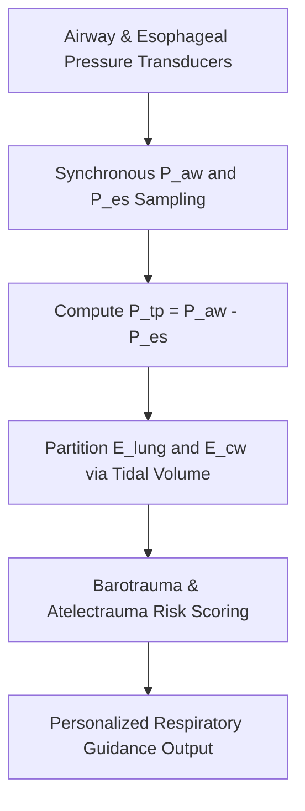

# Pulmonary Transpulmonary Pressure ($P_{\text{tp}}$) & Esophageal Manometry Skill

[](LICENSE)
[](https://www.python.org/)
[](https://modelcontextprotocol.io/)
[](requirements.txt)
[](https://github.com/alphaparkinc)

A zero-dependency, mathematically rigorous personal agent skill that evaluates transmural lung stress and strain via esophageal balloon catheter manometry, separating parenchymal lung elastance from chest wall stiffness.

## Architecture



## Quick Start

```python
from client import TranspulmonaryPressureManometryClient

client = TranspulmonaryPressureManometryClient()
result = client.evaluate_transpulmonary_mechanics(
    plateau_airway_pressure_cmh2o=28.0,
    peep_airway_pressure_cmh2o=10.0,
    esophageal_pressure_insp_cmh2o=14.0,
    esophageal_pressure_exp_cmh2o=9.0,
    tidal_volume_ml=450.0
)
print("Ptp Inspiratory (cmH2O):", result["transpulmonary_pressures_cmh2o"]["ptp_end_inspiratory_cmh2o"])
print("Lung Elastance Fraction:", result["partitioned_mechanics"]["lung_elastance_fraction"])
print("Diagnosis:", result["clinical_guidance"]["partitioning_diagnosis"])
```

## License
Apache-2.0
